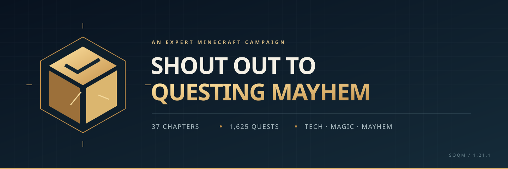

<b>SOQM 0.4.21 · Minecraft 1.21.1 · NeoForge 21.1.262 · Java 21 · Expert · Alpha</b>

**Shout Out to Questing Mayhem (SOQM)** is an Expert Minecraft modpack about
turning a small workshop into an automated empire. Over **1,600 quests across
37 chapters** connect technology, magic and exploration through custom recipes,
material milestones and guided production routes.

## What to expect

- **Quest-guided progression:** follow the main campaign, learn each production
  chain and branch into optional upgrades as your base grows.
- **Hardcore starting workshop:** build expensive furnaces, storage tiers,
  gears and Mekanism machines, then make production efficient through automation.
- **Technology and automation:** progress from Ex Deorum resource gathering to
  Mekanism factories, reactors and Applied Energistics 2 storage and autocrafting.
- **Magic and exploration:** develop Botania Revived and EvilCraft, explore
  The Twilight Forest, The Aether and DivineRPG, and travel into space with Ad Astra.
- **Dimensional dungeon expeditions:** enter puzzle rooms with mixed DivineRPG,
  Twilight Forest and vanilla enemies. Eligible encounters keep their native
  behavior and drops while gaining an Elite Mobs ability and Apotheosis tier augments.
  DivineRPG bosses have an 85% enhancement chance in their native dimensions
  and the Overworld; ordinary DivineRPG hostiles have a 12% chance.
  Follow 12 optional quests in chapter 23 for portal construction, key activation,
  advanced dungeons and trophies, with a personal expedition reward at each step.
- **Demanding late-game crafting:** connect production across mods to make custom
  components and work towards Re-Avaritia recipes.
- **Personal, progressive rewards:** every teammate can claim a quest reward.
  Reward pools improve with team production, and expensive components unlock only
  after the team has actually made them. Preview guaranteed item stacks and all
  possible pack prizes directly in the quest book.
- **Everyday conveniences:** inventory sorting with Inventory Profiles Next,
  light from held torches with LambDynamicLights, upgradeable storage and
  backpacks, recipe lookup, maps and waystones.

**Status: alpha.** Campaign balance, full playthroughs and long-term multiplayer
behavior are still being validated.

## Play

Requires **Minecraft Java Edition, Java 21 and NeoForge 21.1.262**.

**Updating from 0.4.9 or earlier:** empty and remove Iron Chests on the
previous version before installing this candidate. The mod is retired; containers
are not automatically converted. Follow the [storage migration guide](docs/STORAGE_MIGRATION.md).

1. Open [Actions → Validate and package](https://github.com/lsanarchist/SOQM/actions/workflows/validate.yml)
   and choose a successful run for the commit you want.
2. Download `SOQM-candidate-<commit>` and extract GitHub's outer ZIP.
3. Import the enclosed `SOQM-0.4.21-curseforge.zip` into the CurseForge App.

CI candidates are retained for 14 days. The
[installation guide](docs/INSTALL.en.md) covers local builds, other launchers
and updating existing worlds. GitHub's **Source code** archive contains the
repository; use the **installation ZIP** to create a game profile.
The build assembles the chapter-based quest translations into the files
required by FTB Quests; copying the repository's `overrides/` alone omits them.

## Learn more

[Installation](docs/INSTALL.en.md) · [Mod list](MODLIST.md) ·
[Quest routes](docs/QUEST_BRANCHES.md) · [Rewards](docs/REWARDS.md) ·
[Hardcore workshop](docs/HARDCORE_WORKSHOP.md) · [ME recipe transfer](docs/AE2_JEI_INTEGRATION.md) · [MekaSuit and plastic](docs/MEKASUIT_PLASTIC_QUESTS.md) ·
[Multiblock checklists](docs/MULTIBLOCK_MATERIALS.md) · [Quest map](docs/QUEST_LAYOUT_READABILITY.md) ·
[Storage upgrade](docs/STORAGE_MIGRATION.md) ·
[Optional exploration](docs/OPTIONAL_EXPLORATION.md) · [Dungeon loot](docs/EXPLORATION_LOOT.md) ·
[Dimensional Dungeons and elite mobs](docs/DIMENSIONAL_DUNGEONS.md) ·
[Equipment slots](docs/ACCESSORY_POLICY.md) ·
[Changelog](CHANGELOG.md) · [Validation reports](reports/README.md) ·
[Development and release guide](docs/RELEASE.en.md)

## Credits

Created by **lsanarchist**, building on the Questing Mayhem Expert 0.4.6 base.
Questing Mayhem inspired the name; Craftoria is a reference for presentation
and usability. SOQM is independent of both teams.

[Mod authors and licenses](THIRD_PARTY_NOTICES.md) · [Project license](LICENSE)

Not an official Minecraft product. Not approved by or associated with Mojang or Microsoft.
