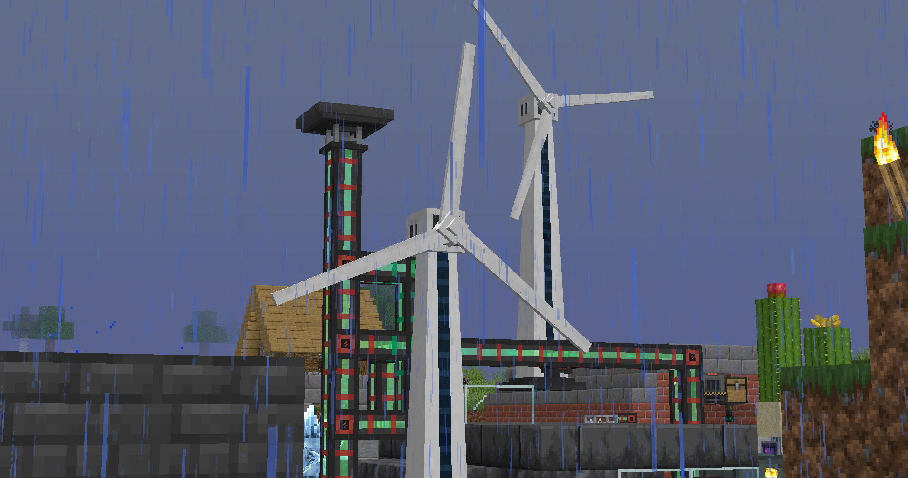
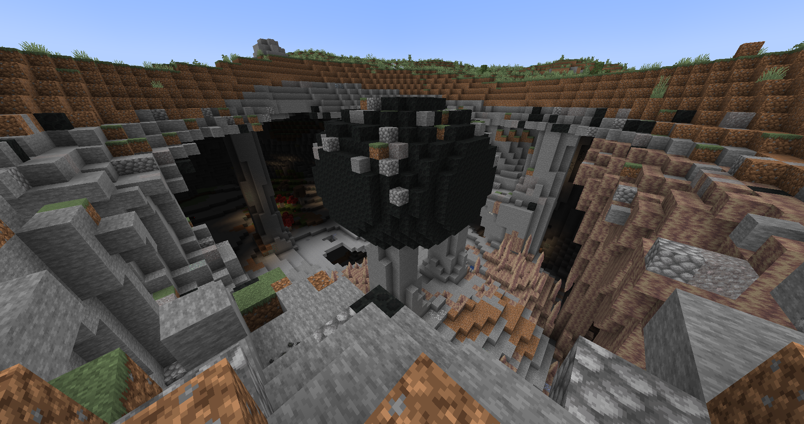
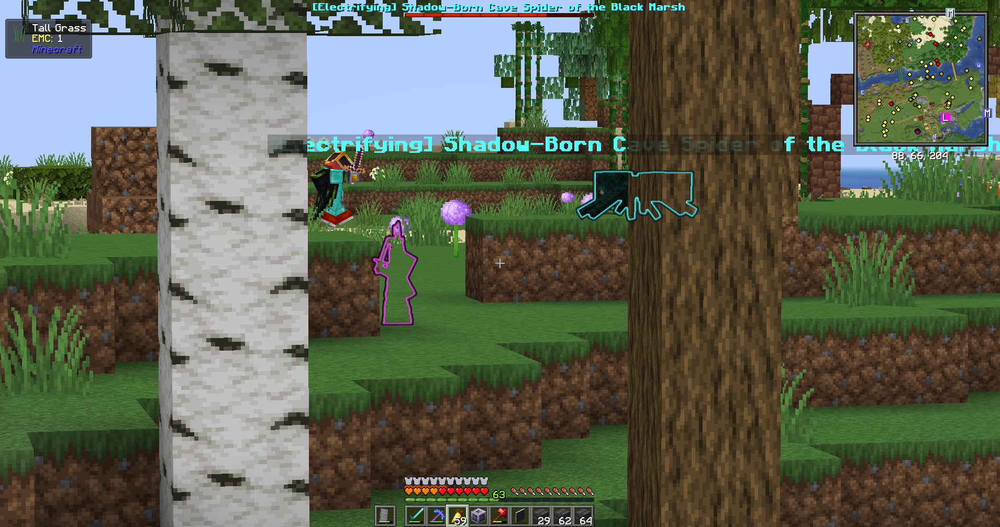
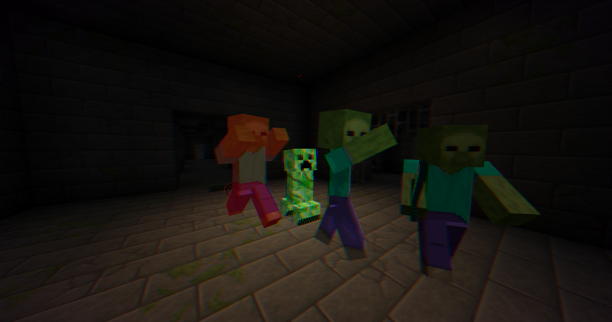
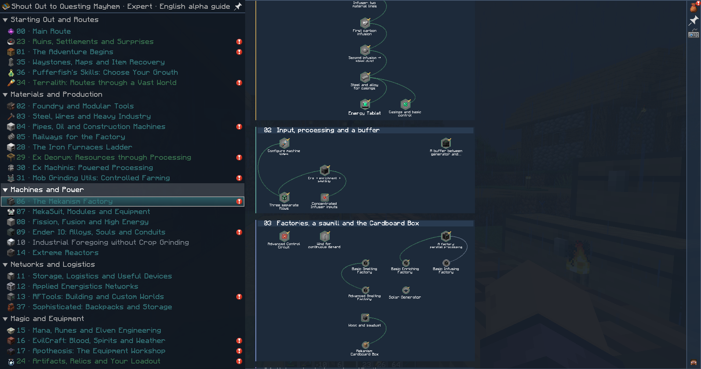

<b>SOQM 0.4.21 · Minecraft 1.21.1 · NeoForge 21.1.262 · Java 21 · Expert · Alpha</b>

<a href="#screenshots">Screenshots</a> · <a href="#main-mods">Main mods</a> · <a href="MODLIST.md">Full mod list</a> · <a href="#play">Installation</a>

**Shout Out to Questing Mayhem (SOQM)** is an Expert Minecraft modpack with
technology, magic and exploration. Over **1,600 quests across 37 chapters**
guide production chains, custom recipes and progression between mods.

## Screenshots

Gameplay screenshots from SOQM. Click an image to open the original.

<table>
  <tr>
    <td width="50%">
       
      Wind generators and base power network.
    </td>
    <td width="50%">
       
      Meteorite and exposed caves.
    </td>
  </tr>
  <tr>
    <td width="50%">
       
      Elite enemies in the Overworld.
    </td>
    <td width="50%">
       
      Dungeon encounter.
    </td>
  </tr>
</table>

*The Mekanism chapter in the quest book.*

## Main mods

| Category | Mods |
| --- | --- |
| Technology and energy | Mekanism, Mekanism: Generators, Immersive Engineering, Industrial Foregoing, Ender IO, Extreme Reactors, BuildCraft Community Edition, Modern Foundry |
| Resource automation | Ex Deorum, Ex Machinis: Divitiae Deorum, Mob Grinding Utils, Iron Furnaces |
| Storage and transport | Applied Energistics 2, Sophisticated Storage, Sophisticated Backpacks, Storage Drawers, Ender Storage, Railcraft Reborn |
| Magic and late game | Botania Revived, EvilCraft, ProjectE, Re-Avaritia |
| Dimensions and dungeons | The Twilight Forest, The Aether, DivineRPG, Ad Astra, Dimensional Dungeons, RFTools Dimensions |
| World and structures | Terralith, Millénaire, Dungeons and Taverns, Abandoned Tunnels, Ember's Underground Rooms, Twilight Treehouses |
| Combat and equipment | Apotheosis, Elite Mobs, Pufferfish's Skills, Relics, Artifacts |
| Quests and utilities | FTB Quests, FTB Teams, FTB Ultimine, JEI, Jade, Waystones, Xaero's Minimap, Xaero's World Map, Inventory Profiles Next |

**[Full mod list with versions and exact downloads](MODLIST.md)**

## Progression

- [Production routes](docs/QUEST_BRANCHES.md) guide resource processing,
  automation, storage and energy. [Expert workshop recipes](docs/HARDCORE_WORKSHOP.md)
  connect machines through custom components, leading to Re-Avaritia crafting.
- [Dimensional Dungeons](docs/DIMENSIONAL_DUNGEONS.md) has 12 optional quests
  and mixed enemy encounters. Dungeon exploration does not block technological
  progression; the guide explains elite abilities and DivineRPG enhancements.
- [Quest rewards](docs/REWARDS.md) are personal for each teammate. Reward pools
  grow with the team's production, and the quest book previews the available prizes.

**Status: alpha.** Campaign balance, full playthroughs and long-term multiplayer
behavior are still being validated.

## Play

Requires **Minecraft Java Edition, Java 21 and NeoForge 21.1.262**.

**Updating from 0.4.9 or earlier:** empty and remove Iron Chests on the
previous version before installing this candidate. The mod is retired; containers
are not automatically converted. Follow the [storage migration guide](docs/STORAGE_MIGRATION.md).

1. Open [Actions → Validate and package](https://github.com/lsanarchist/SOQM/actions/workflows/validate.yml)
   and choose a successful run for the commit you want.
2. Download `SOQM-candidate-<commit>` and extract GitHub's outer ZIP.
3. Import the enclosed `SOQM-0.4.21-curseforge.zip` into the CurseForge App.

CI candidates are retained for 14 days. The
[installation guide](docs/INSTALL.en.md) covers local builds, other launchers
and updating existing worlds. GitHub's **Source code** archive contains the
repository; use the **installation ZIP** to create a game profile.
The build assembles the chapter-based quest translations into the files
required by FTB Quests; copying the repository's `overrides/` alone omits them.

## Learn more

[Installation](docs/INSTALL.en.md) · [Mod list](MODLIST.md) ·
[Quest routes](docs/QUEST_BRANCHES.md) · [Rewards](docs/REWARDS.md) ·
[Hardcore workshop](docs/HARDCORE_WORKSHOP.md) · [ME recipe transfer](docs/AE2_JEI_INTEGRATION.md) · [MekaSuit and plastic](docs/MEKASUIT_PLASTIC_QUESTS.md) ·
[Multiblock checklists](docs/MULTIBLOCK_MATERIALS.md) · [Quest map](docs/QUEST_LAYOUT_READABILITY.md) ·
[Storage upgrade](docs/STORAGE_MIGRATION.md) ·
[Optional exploration](docs/OPTIONAL_EXPLORATION.md) · [Dungeon loot](docs/EXPLORATION_LOOT.md) ·
[Dimensional Dungeons and elite mobs](docs/DIMENSIONAL_DUNGEONS.md) ·
[Equipment slots](docs/ACCESSORY_POLICY.md) ·
[Changelog](CHANGELOG.md) · [Validation reports](reports/README.md) ·
[Development and release guide](docs/RELEASE.en.md)

[Mod authors and licenses](THIRD_PARTY_NOTICES.md) · [Project license](LICENSE)

Not an official Minecraft product. Not approved by or associated with Mojang or Microsoft.
