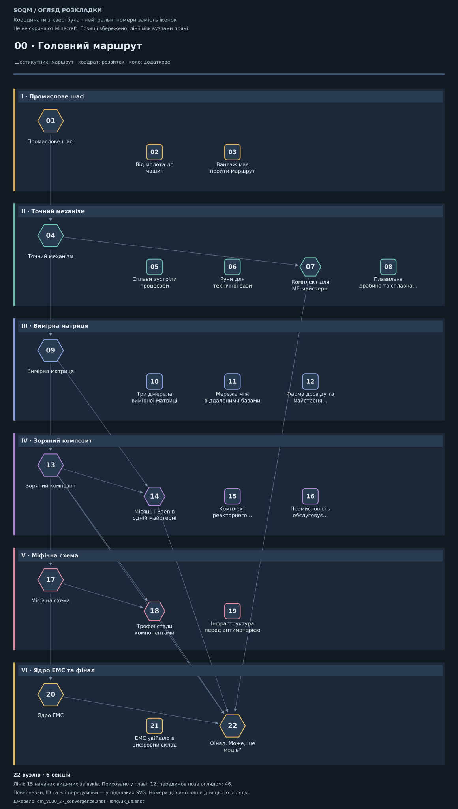
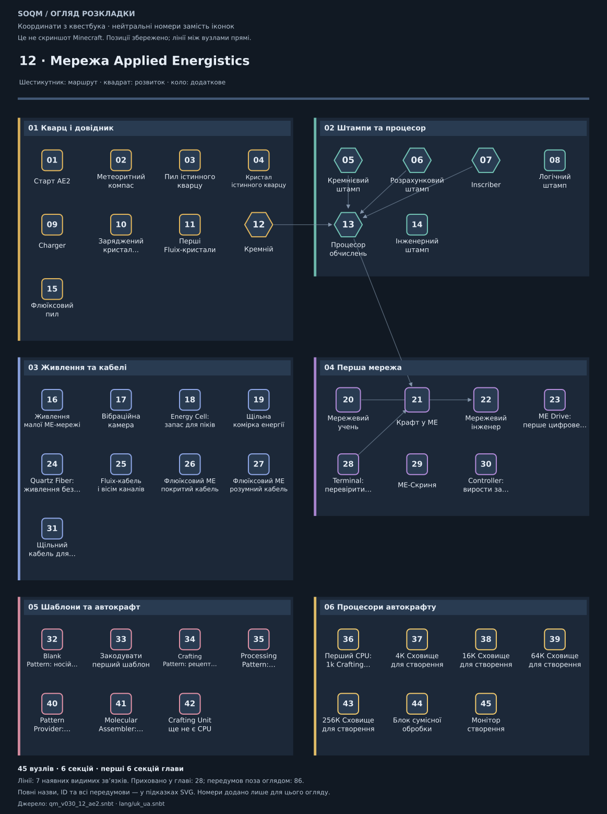

# SOQM 0.4.7: маршрут, навчання й нагороди

Оновлення підготовлено поверх `main` **e71db8398ddc9f07e85981fac942f52dd23f447d**,
уже з Cannibal 0.4.1 та короткими українськими кнопками Apotheosis. Усі
**1625 квестів, 1772 задачі та 1626 зовнішніх нагород** зберігають свої ID.

## Що змінилося після аудиту

| Проблема | Реалізована зміна | Як перевіряється |
| --- | --- | --- |
| Головний маршрут сховано у главі 27 останньої групи | `00 · Головний маршрут` стоїть першим. Шість вертикальних карток мають видиму послідовність матеріальних рубежів | Порядок групи, вузлів і зв’язків перевіряється тестами; координатне прев’ю нижче |
| Майже всі вузли однакові; додаткові гілки губляться серед основних | Роль обчислюється з актуального графа: шестикутники для передумов фіналу, більші матеріальні рубежі, квадрати для практики й розвитку, кола для додаткового | Тести зіставляють роль із реальними залежностями, прапорцем optional та типами задач |
| Довгі жартівливі назви, повтори та нечіткі підписи | Скорочено 1525 назв, прибрано 1453 повторювані вступи; підписи Fluix називають матеріал. Назва підпису прив’язана до ID квесту | Білінгвальна схема всіх 251 секції, перевірка геометрії та стабільності генератора |
| Патчноти й старі списки суперечать рецептам | Прибрано 2287 застарілих абзаців. ME Drive має актуальне пояснення залізних блоків, золотої скрині, процесорів і компонента керування | 67 основних уроків звірено з авторськими рецептами та закріпленими JAR; докази у метаданих уроків |
| Книга вимагає процесори раніше, ніж пояснює їхню підготовку | Кварц, штампи, Inscriber і Charger доступні після шасі, перед Calculation Processor та Precision Mechanism | Граф без циклів; перевірка раннього маршруту й прямого FE-живлення машин |
| Перший AE2-автокрафт відкладено за експедиції | Crafting Unit і Molecular Assembler використовують шасі замість матриці; решта Expert-інгредієнтів збережена. На етапі 2 є робочий 1k CPU | Перевірка рекурсивних авторських та нативних проміжних рецептів |
| Просте послаблення рецепта Unit відкривало б дорожчі CPU | Матриця потрібна для компонентів 4k/16k. Це охоплює рецепти та штатне покращення CPU у світі | Перевірка точних AE2 recipe ID та збережених нативних assembly/transform маршрутів |
| «ME-майстерня» обіцяє готову систему, перевіряючи лише блоки | Назва — «Комплект ME-майстерні», умова чесно описана як підготовка. Окремий наявний квест термінала перевіряє справжній крафт | Нативний тест AE2 output-click та FTB AdvancementTask; негативні й позитивний сценарії |
| Скафандр і кисень вивчалися після Місяця | Передпольотні задачі передують першій місячній експедиції; Desh передує Stellar Alloy. Виправлено прив’язку досліджень Меркурія | Тести залежностей, актуальних матеріальних етапів і відсутності циклу |
| Етапи печей і реакторів обіцяли обладнання завчасно | Мітки й передумови звіряються з обов’язковими матеріалами рецептів: зокрема Diamond Furnace потребує матриці, реакторні деталі — місячного Desh для захисту | Рекурсивний аналіз усіх авторських альтернатив без вигадування джерел для звичайних тегів |
| Великі виплати за дешеві речі роздувають запаси | 1611 звичайних нагород використовують 14 тематичних пулів. Приз — одна мала стопка; вибрані 14 рубежів залишають по одному кубу | Точні математичні бюджети, заборона ключових компонентів, реальна видача й блокування повтору у FTB |
| Англійські `Section N` і загальні вказівки не допомагають навігації | Усі 251 секція має переклад; 67 основних уроків написано двома мовами; інші цілі походять із задач | Рівність наборів ключів, відсутність кирилиці в EN і перевірка свіжості |
| Нове виправлення Cannibal не проходило повного старту світу | Збережено його готовий JAR, додано свіжі запуск світу/reload та окремі інтеграційні сценарії на всьому серверному наборі | [Нативний стенд](RUNTIME_VALIDATION.md) та [поточні результати](../reports/README.md) |
| Немає зручного інсталяційного пакета для перевірки PR | Workflow перевіряє дані, збирає ZIP і зберігає інсталяційний кандидат разом із SHA256SUMS | Архів проходить перевірку CRC, точного складу, хешів і відтворюваності |

## Карта квестбука

У поточному графі **94 вузли** є передумовами фіналу або самим фіналом.
**105** інших вузлів перевіряють практичні дії, **897** описують розвиток
модів через предметні задачі, **529** позначено додатковими. Ці числа описують
квестові залежності; рецепти також потребують матеріалів із різних гілок.
Вони не оцінюють тривалість проходження чи повний обсяг виробництва.

На головній карті наступний матеріальний рубіж розміщено нижче попереднього,
а прикладні проєкти відсунуті під нього. Видимі прямі зв’язки не проходять
через іконки сусідніх проєктів. Інші глави зберігають тематичні картки;
DivineRPG спочатку показує послідовність острівних світів, потім окремі
експедиції, а в AE2 перший автокрафт піднято ближче до першої мережі.

Наведені зображення генеруються з фактичних координат, розмірів, підписів і
видимих локальних залежностей. Це **прев’ю структури, не знімки гри**:
позначки всередині вузлів замінюють предметні іконки. Масштаб тексту й
кінцеву читабельність треба перевірити у клієнті.

## Навіщо ранній AE2 не прибирає Expert-прогресію

Змінено лише два інгредієнти наявних базових рецептів: матрицю замінено шасі
в Crafting Unit та Molecular Assembler. Збережені Ender IO Crafter, RFTools
Crafter T1, процесори й інші компоненти вимагають попередньої інфраструктури.
Контролер, віддалені мережі, квантова та просторова автоматизація мають свої
пізні передумови.

Для CPU потрібне **1k Crafting Storage**; сам каркас Unit не містить пам’яті.
Декілька дорогих 1k-блоків можна об’єднати — штучної межі сумарної пам’яті
немає. Матриця обмежує саме **4k+ компоненти**, тому штатне покращення Unit
компонентом у світі не обходить обмеження. Рецепти 4k/16k замінено за точними
ID установленої AE2 19.2.18.

Новий квест термінала перевіряє ручне отримання результату через справжнє
вікно ME Crafting Terminal, живлення, активний канал і непорожнє ME-сховище.
Відтворюваний приклад: залишити один камінець у сховищі та скрафтити колоду
в дошки через термінал. Автономне виконання замовлення через Pattern Provider
описане окремим уроком, але цей тригер його не вимірює.

## Нагороди: різноманітність без великих повернень

Пули відображають теми виживання, інструментів, інженерії, логістики,
переробки, магії, енергії, експедицій, космосу, поселень та фіналу. Для кожної
глави задано тему й допустимий етап. Якщо етап ще ранній, використовується
безпечний початковий пул. Усі таблиці містять додатні ваги із сумою 100,
один вибір і видимі шанси.

Типовий приз — **1–4 витратні предмети**. Пізні таблиці також містять невеликі
шанси пляшки досвіду, золотої моркви, смарагда або бирки. Прогресійних
компонентів, HDPE, машин, ключів і вкладених випадкових кубів у звичайних
пулах немає. Важливі рубежі мають окремий гарантований куб.

Колишні три завдання на залізні інструменти більше не повертають 96 злитків:
їхній пул взагалі не видає заліза. Середнє пряме залізо з усіх 1611 звичайних
нагород — приблизно **139 злитків за всю книгу**. Це математичне очікування
припасів, а не сумарна економіка збірки; події Mayhem Cubes рахуються окремо.
Точні шанси, розподіл по етапах та інші бюджети наведено в [REWARDS](REWARDS.md).

## Оновлення наявного світу

Назви, положення, вид нагороди та частина передумов змінюються без нових ID.
Перевірка збережень фіксує не тільки набір ID, а й те, які задачі й нагороди
належать кожному квесту та чи є нагорода командною. Перенесення задачі під
інший квест з тим самим ID також вважається помилкою.

FTB зберігає отримання нагороди за зовнішнім ID і командним/особистим
режимом. Уже отримані предметні нагороди не видаються повторно після
перетворення на random; ще не отримані використовують нову таблицю. Стара
особиста книга залишається окремою нагородою для кожного гравця.
Наявні ресурси в інвентарях і вже відкриті скрині не перераховуються.

Один наявний предметний task ME-термінала став advancement task, зберігши
свій ID. Завершений старий прогрес не відкочується. Незавершений квест тепер
потребує описаної дії. Нативний стенд перевіряє старий непорожній TeamData,
отримані нагороди, часткові задачі, двох гравців, запис на диск та reload.

Перед переходом збережи копію світу й усього профілю. Онови повний комплект
файлів збірки та перевір копію світу. Резервна копія потрібна й для відкату
рецептів: завантаження оновленого світу старим пакетом не є перевіреним шляхом.

## Межі цієї зміни

Предметні довідкові задачі збережено як задачі на наявність предметів.
Їхні описи й ролі не видають їх за вимірювання діючої фабрики. Додано одну
справжню ME-перевірку й конкретні інструкції до основних механік; повна
телеметрія кожної машини не заявляється.

Виправлення Cannibal залишається адресним. Для Millénaire перевірено
вихідний потік виконання закріпленої версії: переносити перевірку чанків
на початок генерації без вибраного типу поселення та правильного власника
повтору небезпечно для результату генерації. Таку заміну не внесено.
Профілювання подорожей залишається окремим вимірюванням; немає заявленого
приросту FPS/TPS чи універсального виправлення генерації. Деталі й
відтворюваний сценарій — у [RUNTIME_VALIDATION](RUNTIME_VALIDATION.md).

Повне виживання, графічний інтерфейс, фінальна читабельність, multiplayer
економіка та темп усієї кампанії потребують ігрових сесій. Точні результати
виконаних перевірок прив’язано до поточного payload у [reports](../reports/README.md).
